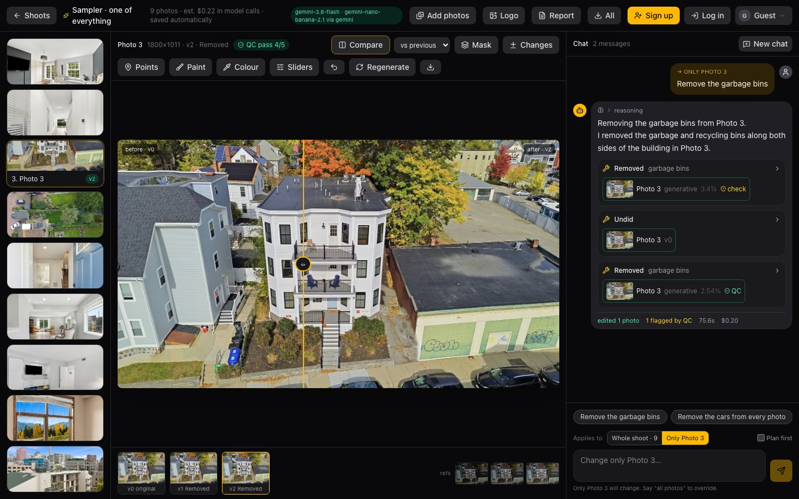
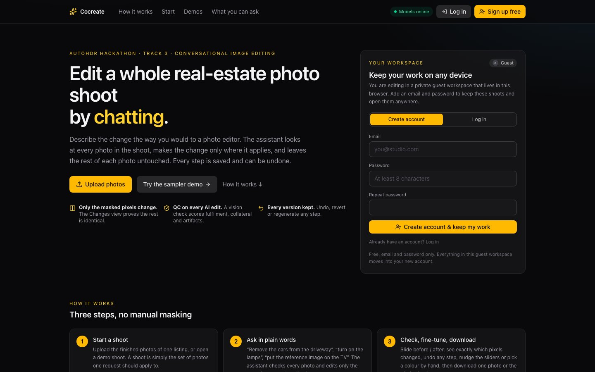
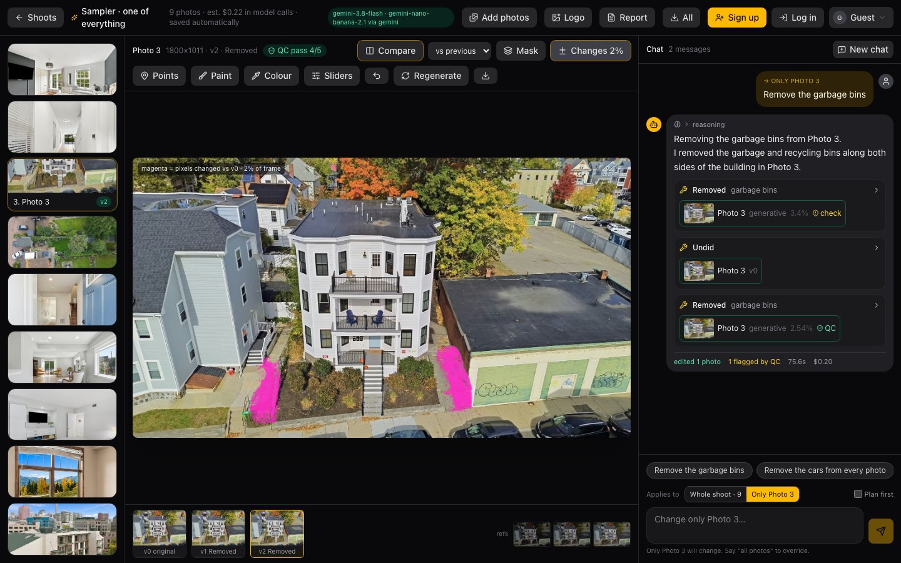
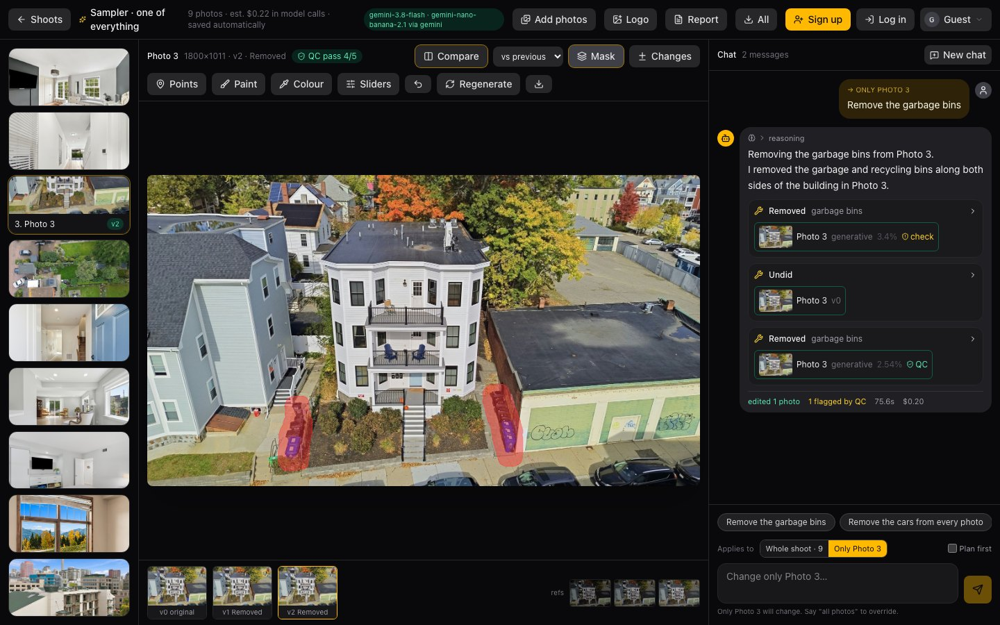
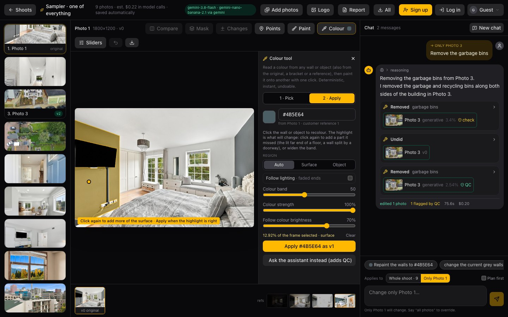
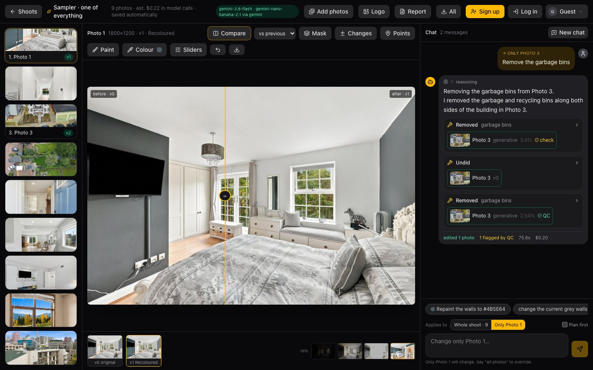
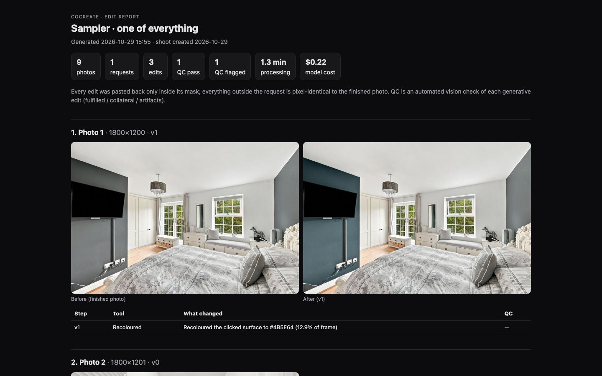

# Cocreate — conversational real-estate photo editing

**AutoHDR hackathon · Track 3.** A photographer or agent describes a change in chat; the agent looks at every photo in
the shoot, picks the right tool per photo, runs the edits, QC-checks them and shows before / after. Everything outside
the request stays byte-for-byte intact, and the UI proves it.



**Why it stands out**

- **Whole-shoot understanding.** One request, nine photos: the planner edits the ones it applies to and says what it skipped.
- **Proof, not promises.** The **Mask** view shows the exact region a model was allowed to touch; the **Changes** view
  paints every pixel that differs in magenta. A vision QC pass scores fulfilled / collateral / artifacts on every AI edit.
- **Colour done right.** Sample a wall colour from the original brackets or the customer's reference and repaint with texture
  and shading kept; or use the **Colour tool**: eyedropper on any wall or object, one click to recolour another, under a second.
- **Fix anything by hand.** Paint a missed spot and say what to do there, nudge sliders that track the chat edit, undo or
  revert any version, regenerate a flagged edit.
- **Built to be used tomorrow.** Private guest workspaces with no sign-up, accounts that keep the work, per-shoot request
  isolation, downloads, and a self-contained HTML report for the customer.
- **Measured.** 70.5 % strict-judge pass on AutoHDR's 200 real customer requests (up from 42 % at the first version), a
  per-tool coverage suite, and automated isolation and concurrency checks.

| | |
|---|---|
|  |  |
| Home page: sign up or log in right in the hero; guests already have a private workspace | **Changes** view after a removal: 2 % of the frame moved, nothing else |
|  |  |
| **Mask** view: detection → GrabCut → contact shadow, per bin | **Colour tool**: teal picked from the customer reference, the grey wall highlighted before applying |
|  |  |
| The recolour as a new version, texture and shadows kept | **Report**: every request, edit, QC verdict and before / after, one file to forward |

Docs: [architecture](docs/ARCHITECTURE.md)

## How it works

```
chat ──► planner (Gemini 3.8 Flash, function calling, streams status + intent) ──► tools ──► versions ──► QC verdict
                      │                                                             │
                      └── sees: thumbnails of every photo, per-photo edit log,       └── every result is composited
                          conversation memory, scope (whole shoot / only photo N)        into the original through a
                                                                                         feathered mask
```

| Request | Tool | How |
|---|---|---|
| remove X (AutoRemove) | `remove_object` | Gemini detection boxes (tiled on aerials for small objects) → GrabCut mask + contact-shadow extension → classical pre-erase → Nano Banana repairs each close-up window → composite |
| repaint wall / floor to hex or reference (Re-Paint) | `sample_color` + `repaint` | edge-aware colour-region mask (crosses cables and grout, stops at cabinets and roofs), detected windows / artwork / furniture carved out, LAB chroma swap keeping texture and shading, QC verdict; bracket samples are exposure-matched |
| brightness / contrast / warmth / shadows / sharpen | `adjust` | slider maths, optional region; the UI previews the same maths live in the browser |
| reference on the TV / blackout | `tv_screen` | detect panel → screen quad → perspective-warp the reference (pixel-exact, free) |
| lamps on, bedding, lawn, blinds, fire, declutter, sky, twilight… | `generative_edit` | Nano Banana on a close-up window around the protected object, pasted back through its mask; no-op detection + retry |
| lot lines | `draw_lot_lines` | polygon from the points the user clicks |
| watermark / "Digitally altered" disclosure | `add_watermark` | text or uploaded logo; disclosure preset |
| blur faces / plates / house numbers | `blur` | detection + gaussian or mosaic |
| make photos match | `match_look` | LAB statistics transfer toward a reference photo |
| straighten / crop | `crop_rotate` | deterministic |
| undo / revert | `undo`, `revert_to` | every version is kept |
| "also fix this spot" (Paint) | `painted_area` on repaint / remove / generative | the user paints a region on the photo; it is added to what detection finds (or used alone) so a missed strip, an undetected object or a precise area can be fixed in one message |
| pick a colour here, apply it there (Colour tool) | `color-at`, `region-at`, `apply-color` endpoints, no planner | eyedropper reads the paint colour of the wall or object under a click (median of the whole surface grown from the click, also from a bracket or a reference image); one click on another wall or object recolours it: colour growth bounded by step edges with a fitted shading plane, GrabCut around the click for objects, LAB recolour keeping texture; sub-second, undoable |

After every generative edit a vision QC pass (before, after, and a changed-pixel map) scores fulfilled / collateral /
artifacts; the planner retries flagged photos once and the UI shows the verdict.

## UI
- **Home page**: top bar with section links and the account controls, a hero with upload / demo buttons and a
  **workspace card**: guests see the sign-up / log-in form right there (signing up keeps the guest's shoots), members see
  their account, shoot count and a "continue last shoot" button; then how-it-works, upload, demo shoots with the
  customer's real request on each card, and a "what you can ask for" overview.
- **Colour tool** in the editor: pick a colour from any wall or object of the current photo, its original, a bracket
  or a customer reference (lit / surface / spot / shade variants), or choose any colour with the colour wheel, a hex
  field or twelve common paint presets; then click the wall or object to recolour. The highlighted region updates live
  with the colour band and Auto / Surface / Object modes, extra clicks add more of the surface, **Follow lighting**
  extends into the part of a floor or wall that fades into strong light (opt-in because near-white neighbours can
  join), and **Add / Erase brushes** adjust the area by hand before applying (the strokes are unioned with or cut out
  of the detected region at full resolution). "Ask the assistant instead" sends the point and colour through the
  planner with QC.
  The picked colour also appears as a chat chip ("Repaint the walls to #4B5E64").
- **Scope control**: "Whole shoot" (agent decides per photo and reports what it skipped) or "Only Photo N".
- **Paint** mode: brush over any area, then say what to do there; **Report** exports a self-contained HTML page with every
  request, edit, QC verdict and before/after per photo, ready to send to the customer.
- **Plan first** toggle: the agent describes photos, tools and what stays unchanged, then waits for an OK.
- Live status line, streamed intent and tool cards with per-photo results, QC badges, cost and timing.
- Before/after slider, mask view, **Changes** heatmap (every pixel that differs), version strip, points.
- **Sliders** preview live in the browser and track what the assistant applied: a chat "brighten 20%" moves the
  brightness slider to +20 and opens the panel; dragging it re-renders from the pre-adjustment image and saves a new version.
- Shoots, chats, versions and conversation memory are saved on the server; **New chat** archives the old one;
  older turns are folded into memory notes so long conversations keep their context.

## Accounts and tenant isolation
Three modes (`AUTH_MODE`). **guest** (deploy default, also set in `.env` here): every visitor silently gets a private
guest workspace, nothing to sign up for; the home page offers **Sign up** / **Log in**, and signing up turns the guest
workspace into a real account without losing anything. Only accounts are protected across browsers and devices; a
guest workspace lives in that browser's session. **required**: login wall (guest button still offered). **open**:
single-user local mode, no accounts. Every shoot has an owner; listing, opening, editing, downloading, the report and
the image URLs under `/files/shoots/...` answer 404 for anyone else. Sessions are opaque tokens in an HttpOnly cookie
(30 days, sliding), passwords are scrypt-hashed, logins throttled, and password change or reset signs out every other
device. Reset links are emailed when `SMTP_*` is configured, otherwise printed in the server log
(`AUTH_SHOW_RESET_LINK=true` returns them in the API response, for dev only). The first real account created claims
shoots made before accounts existed. Users live in `data/users.sqlite`; on Render's free tier that disk is ephemeral.

```bash
cd backend && uv run python tests/test_auth_isolation.py http://127.0.0.1:8020   # server in required mode
cd backend && uv run python tests/test_guest_mode.py http://127.0.0.1:8022        # server in guest mode
```

## Isolation and concurrency
Every request streams into state keyed by its shoot, in the browser and on the server, so opening another shoot while a
request runs never shows that request's messages, progress or edits there (the header says "1 other shoot still
working" and the home page marks it). Requests on different shoots run in parallel; two requests on the same shoot
are queued (the second reports "Waiting for the previous request on this shoot to finish") so tool calls, transcript
and chat can never interleave. CPU-heavy steps (GrabCut, colour growth, compositing, slider maths) run on worker
threads so one edit does not stall other users' streams. Uploads are capped (60 photos, 40 MB each, images only),
chat requests at 4000 characters, CORS is same-origin, and responses carry `X-Frame-Options: DENY`,
`X-Content-Type-Options: nosniff` and a same-origin referrer policy.

```bash
cd backend && uv run python tests/test_concurrency.py http://127.0.0.1:8021   # against a server started with COCREATE_MOCK=1
```

## Run

```bash
cp .env.example .env            # add GEMINI_API_KEY (one key runs planner, masks, edits and QC)
./dev.sh                        # backend :8000 (uv) + Vite :5173
# or
docker build -t cocreate . && docker run -p 8000:8000 --env-file .env cocreate
```

`render.yaml` deploys the Docker image on Render's free tier (set `GEMINI_API_KEY` in the dashboard). The free tier
has an ephemeral disk, so saved shoots disappear on redeploy; demo shoots rebuild from the dataset in seconds.

Optional keys: `ANTHROPIC_API_KEY` switches the planner to the Anthropic API; `FAL_KEY` switches masks to SAM-3 and fills to
LaMa / FLUX Fill. `COCREATE_MOCK=1` runs fully offline.

## Evaluation on AutoHDR's 200 real customer requests

`backend/tests/eval_dataset.py` turns every record into a single-photo shoot (finished photo + brackets + references),
sends the request verbatim through the production planner, and scores the result with a strict vision judge that sees
before, after and a changed-pixel map. Results: `data/eval/<run>/summary.md`.

```bash
cd backend && uv run python tests/eval_dataset.py --run v3 --concurrency 3 --judge
```

`backend/tests/smoke_new_photos.py` does the same on photos that are **not** in the dataset: it builds one multi-photo
shoot from a folder, runs whole-shoot requests through the planner and reports which photos were edited vs. expected
plus the judge verdict per edited photo (results in `data/eval/newphotos/<run>/summary.md`).

```bash
cd backend && uv run python tests/smoke_new_photos.py --photos ~/Pictures/listing --judge --run listing1
```

`backend/tests/tool_coverage.py` is the per-tool regression suite: one curated request per tool (adjust, sharpen, lot
lines from points, blur, match look, crop / straighten, undo, watermark, sample + repaint from a reference, repaint to
a hex, three removals, lamps across a shoot, TV screen) plus the direct colour tool, each checked for tool choice,
which photos changed and the judge verdict. Groups run on separate shoots in parallel (about 10 minutes, roughly $1).

```bash
cd backend && uv run python tests/tool_coverage.py --run tools1 --judge      # data/eval/tools/tools1/summary.md
```

## Cost
Planner turn ≈ $0.01 · detection ≈ $0.001 · Nano Banana window ≈ $0.034 (1K) / $0.05 (2K) · QC ≈ $0.004 ·
deterministic tools free. A typical removal across a 9-photo shoot costs well under $0.50.
